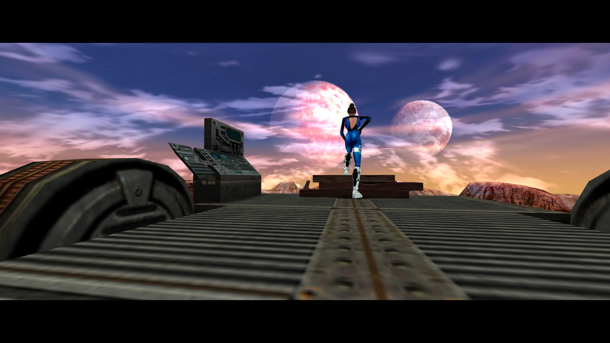
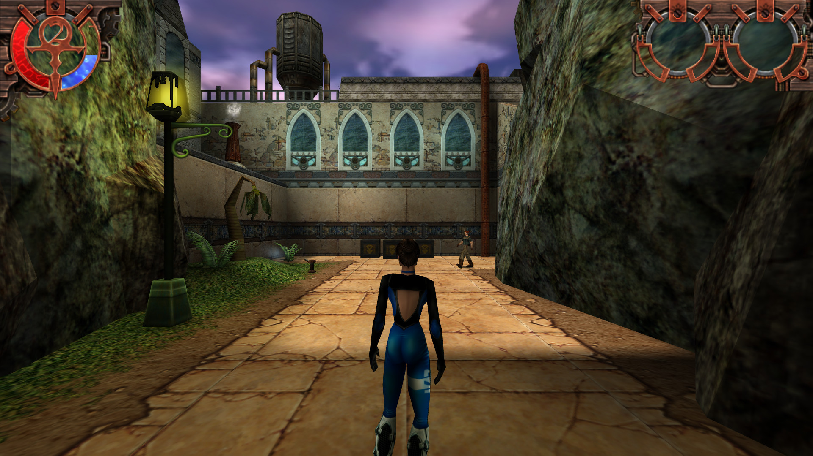
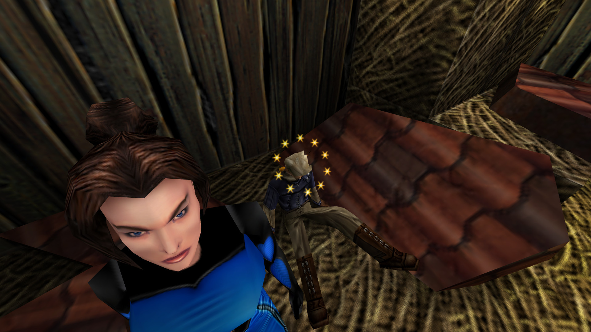
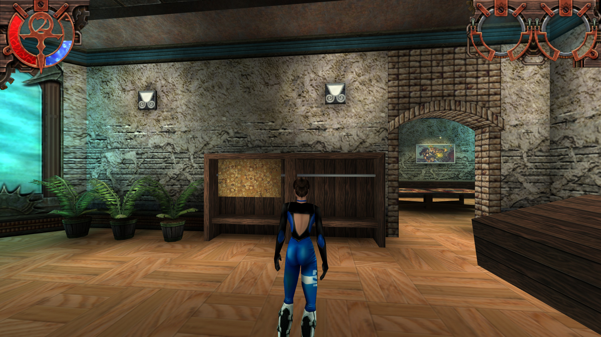
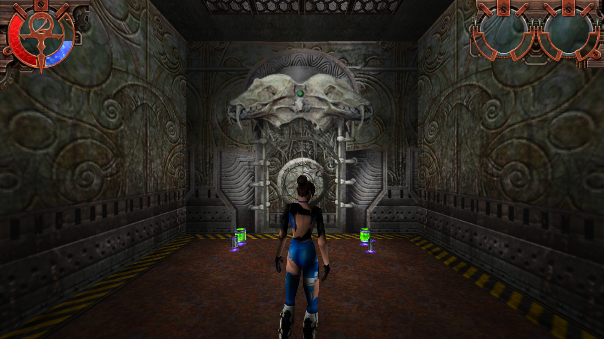
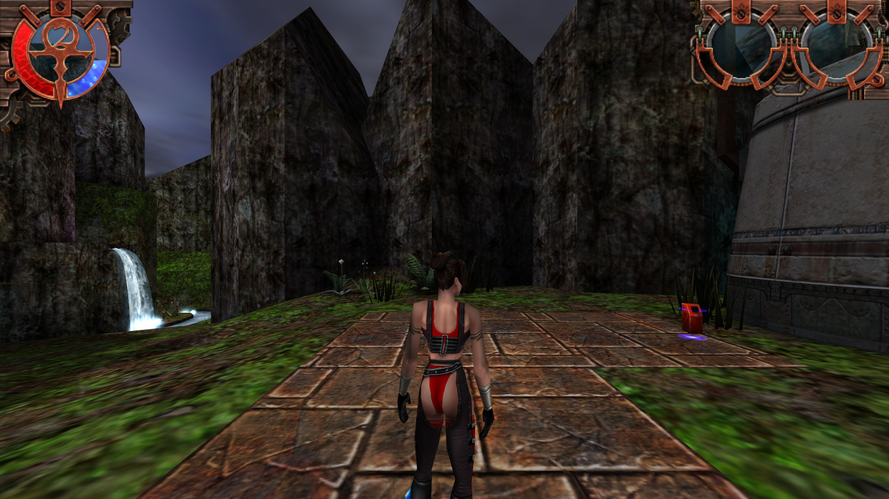

# OpenFAKK2

## What is OpenFAKK2?

OpenFAKK2 is a source port of Ritual Entertainment's *Heavy Metal: F.A.K.K. 2* (2000): a
new engine for the original game, aiming to be to FAKK2 what ioquake3 is to Quake III Arena.
It brings none of the game: you need the original, patched to 1.02.

- **Plays like the original.** The engine is rebuilt from what the retail `fakk2.exe` does,
  read from the executable and checked against it: the same level scripts, the same AI,
  the same lighting, menus, sounds and saves, down to the original's quirks.
- **Compatible with the original's files.** Your retail saves load, and demos play on either
  game whichever recorded them. It runs the game modules built from Ritual's 1.02 SDK, or
  Ritual's own DLLs.
- **Modern where it helps, and only where you want it.** Widescreen without stretching or
  cropping, HUD size, field of view, brightness that leaves your desktop alone, game
  controllers, every resolution, anti-aliasing, OpenAL sound with optional HRTF. Each can
  be switched back to the original's behaviour.

## Getting started

- [Installing OpenFAKK2](docs/guide/01-installation.md): what you need, and pointing it at
  your game
- [Running the game](docs/guide/02-running.md): the command line, saves, controllers,
  demos, the map viewer
- [FAQ & troubleshooting](docs/guide/03-faq.md)
- [Configuration](docs/guide/04-configuration.md): OpenFAKK2's own settings

## Current state

**Playable, not finished, and not yet released.** The game starts with the retail intro and
menus, and New Game runs the opening cinematic, `fakkhouse` and on into `training`, with
weapons and their effects, the HUD and inventory, sound, music and dialog. Most of it has
been checked side by side with the original. Not yet:

- a playthrough of all 30 levels on OpenFAKK2;
- any platform other than Windows, or a 64-bit build;
- prebuilt binaries ([build it yourself](docs/guide/07-compiling.md)).

More:

- [Differences from the original game](docs/guide/05-differences.md): what's added, what's
  kept as the original had it, and what still differs
- [Status by area](docs/guide/06-status.md): engine, models, renderer, sound, saves, menus
- [`known-differences.md`](docs/known-differences.md): the full record, with what was read
  from the original executable and where

## Reporting issues

OpenFAKK2 hasn't reached a first release, so expect rough edges. A useful report says what
you did and saw, on which level, attaches the console log (`+set logfile 2` writes
`fakk\qconsole.log` in the home folder) and, after a crash, `crash.dmp` from the same
folder, and says whether the original game does the same. See the
[FAQ](docs/guide/03-faq.md#where-do-i-report-a-bug).

## Screenshots

OpenFAKK2 at 1920x1080 with 4x anti-aliasing: the widescreen view and HUD, and two of the
game's own cinematics.

| | |
| --- | --- |
|  |  |
| *fakkhouse: the intro cinematic* | *homes1* |
|  |  |
| *creeperpens: a cinematic* | *landersroost* |
|  |  |
| *shield* | *cliff1* |

The game's art in these is Ritual Entertainment's.

## Building from source

    scripts\build-msvc.cmd x86 Release

needs Visual Studio 2022 (or its Build Tools) with C++; output goes to
`build\x86-Release\Release` (`x64` in place of `x86` for a 64-bit build). Details in
[Building from source](docs/guide/07-compiling.md).

## Development

How the engine is reconstructed from the original executable, the harness that runs both
games side by side, the test suite of 177 checks, and the rules for contributing:
[How OpenFAKK2 is made and checked](docs/guide/08-development.md). OpenFAKK2 is built largely
with AI coding agents (Claude Code), directed and reviewed by its author.

## Third-party libraries

In `code/thirdparty`, built with the engine:

- [SDL 2](https://www.libsdl.org/) 2.32.8: window, input, controllers
- [OpenAL Soft](https://openal-soft.org/) 1.24.3: sound (LGPL 2.1; `OpenAL32.dll` ships
  beside the executable)
- [dr_mp3](https://github.com/mackron/dr_libs): the game's MP3 dialog
- [libjpeg](https://ijg.org/) 9f, [zlib](https://zlib.net/) 1.3.1,
  [libogg](https://xiph.org/ogg/) 1.3.6, [libvorbis](https://xiph.org/vorbis/) 1.3.7,
  [Opus](https://opus-codec.org/) 1.5.2, opusfile 0.12, [curl](https://curl.se/) 8.15.0:
  as bundled with ioquake3

## Licensing

The engine (`code/`, apart from `code/fakk/`) is ioquake3's and GPLv2+ (`COPYING.txt`).

The code under `code/fakk/` is **not**: it is Ritual's FAKK2 1.02 SDK game code (`fgame`,
`cgame`) and the four engine headers it shipped with, copyright Ritual Entertainment and
under Ritual's terms (`code/fakk/LICENSE-re.MD`), not the GPL. It is included as Ritual
released it, patched to compile with a standard C++ compiler and for a few bugs, each
change in its own commit. The game modules built from it carry the same terms. If you
reuse OpenFAKK2, keep the two apart.

## Credits

- **Ritual Entertainment** for *Heavy Metal: F.A.K.K. 2* and its SDK.
- **id Software** for Quake III Arena's engine, and **the ioquake3 project** for keeping it
  alive; OpenFAKK2 starts from ioquake3 `87a99d18`.
- **[OpenMoHAA](https://github.com/openmoh/openmohaa)**, a reference (not imported) for the
  Ritual engine systems FAKK2 shares with *Medal of Honor: Allied Assault*.
